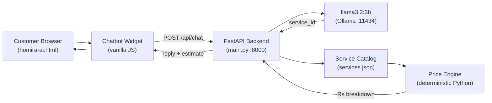

# HACKATHON.md — Hacktoberfest Islamabad 2026 Open AI Build Challenge

## Project: Homira AI

**Short description:**
An open-weight AI home-services assistant that understands household repair requests
in English and Roman Urdu, asks clarifying questions, and produces transparent price
estimates from a verified service catalog — integrated directly into the existing
Homira website.

---

## Challenge Fit

| Requirement | Status | Details |
|---|---|---|
| Open-weight AI (≤8B params) | ✅ | Llama 3.2 3B via Ollama |
| Meaningful original work | ✅ | Triage workflow, price engine, safety system |
| Public GitHub repository | ✅ | Ready to push |
| Open-source license | ✅ | MIT (see LICENSE) |
| Model ≤8B parameters | ✅ | 3.2B parameters confirmed |
| Functional and demonstrable | ✅ | 35 tests pass |
| README with all required sections | ✅ | See README.md |
| Setup and test instructions | ✅ | See README.md |
| Real test results | ✅ | 35/35 unit+API tests pass |
| No secrets in repo | ✅ | .env.example only |
| License compliance | ✅ | All deps verified |
| Original contribution documented | ✅ | See section below |

---

## AI Model Details

| Field | Value |
|---|---|
| Model name | `llama3.2:3b` |
| Parameter count | 3.2 billion |
| Provider / runtime | Meta / Ollama (local inference) |
| License | Meta Llama 3.2 Community License |
| License URL | https://www.llama.com/llama3_2/license/ |
| Commercial use | Permitted (MAU threshold: verify at scale) |
| How it is used | Chat inference only — understands repair problems, identifies service categories, asks follow-up questions, selects a valid catalog service_id. Prices are NEVER set by the model. |

**Why llama3.2:3b?**
- Under 8B parameter limit (3.2B actual)
- Runs on a standard laptop CPU via Ollama (no GPU required)
- Strong multilingual capability for English + Roman Urdu
- Available offline after one download — no API key needed
- Community license permits hackathon use

---

## Architecture



---

## What Is Original Contribution

### Retained from existing Homira website (not new work)
- All HTML pages: Home, Services, Booking, Auth, Dashboard, Admin, Contact
- Design system: CSS variables (`--orange`, `--navy`), typography (Sora + DM Sans)
- Navigation, routing (showPage), localStorage auth/booking system
- Service catalog prices (Rs 800 / 1,200 / 1,500 / 3,500 / 4,000 / 5,500)
- WhatsApp integration, footer, contact information
- Booking flow (3-step form, confirmation)

### New original work for this hackathon
- **AI triage workflow** (`main.py`): multi-turn conversation, structured extraction,
  follow-up question logic, catalog mapping
- **Deterministic price engine** (`calculate_estimate`): validates IDs, multiplies
  quantities, attaches disclaimer — no LLM involved in arithmetic
- **Safety detector** (`is_dangerous`): keyword-based pre-filter for dangerous
  household situations (gas leaks, sparks, fire, flooding)
- **Model output parser** (`extract_action`, `strip_action_block`): structured
  JSON extraction from free-form model text
- **FastAPI backend** with CORS, input validation, error handling, timeout handling
- **Service catalog** (`services.json`): normalized from website prices, with
  keywords for matching, active flag, pricing_type
- **Chatbot widget** (CSS + HTML + vanilla JS injected into existing HTML):
  floating button, chat panel, estimate card, safety card, starter chips,
  Enter-to-send, auto-resize textarea, error/offline handling
- **Automated test suite** (35 tests): price engine, safety, action extractor,
  API endpoints, mocked Ollama, live inference (conditional)
- **HACKATHON.md, README.md, .env.example, .gitignore, LICENSE**

---

## Demo Workflow (2–3 minutes for judges)

**Setup** (done before demo):
```bash
# Terminal 1 — backend
cd homira-ai/backend
python -m uvicorn main:app --reload

# Terminal 2 — Ollama (if not running)
ollama serve
# (model already pulled: ollama pull llama3.2:3b)

# Open file in browser
start homira-ai/homira-ai.html
```

**Demo script:**
1. Show the Homira website is fully intact — navigate Home, Services, Booking.
2. Point out the chat button (bottom-right, above WhatsApp).
3. Click it → greeting appears.
4. Type: **"My kitchen tap is leaking"**
   → Model asks: "Is the leak from the tap or the pipe connection?"
5. Reply: **"From the tap, it's dripping constantly"**
   → Model identifies Tap Repair, backend calculates Rs 800 fixed price, estimate card appears with disclaimer.
6. Click **Book This Service** → redirects to booking page with Plumbing pre-selected.
7. Type: **"There are sparks coming from my socket"**
   → Safety alert card appears immediately (no price estimate).
8. Type: **"Mere room ka switch kaam nahi kar raha"** (Roman Urdu)
   → Model responds and identifies Switch Repair.
9. Show `GET http://localhost:8000/api/services` in browser — live service catalog.
10. Run tests: `python -m pytest tests/test_backend.py -v` → 35 passed.

---

## Known Limitations

1. **Ollama must be running locally.** No Ollama = chatbot shows offline error (clearly displayed). The rest of the website continues to work.
2. **Roman Urdu support is best-effort.** llama3.2:3b handles common phrases well. Complex mixed-script sentences may reduce accuracy.
3. **Safety detector is keyword-based**, not AI-based. It may miss unusual phrasings of dangerous situations. In production, a secondary LLM check is recommended.
4. **CORS is open for localhost.** In production, restrict `FRONTEND_URL` and serve the HTML over HTTP (not `file://`).
5. **Prices are sample data.** All rates in `services.json` are derived from the existing website's listed prices and must be confirmed with actual Homira pricing before launch.
6. **No HTTPS in dev mode.** For production, put the backend behind a reverse proxy with TLS.
7. **Single-file frontend.** The existing Homira site is a single HTML file with localStorage. The AI chatbot integrates cleanly, but a production deployment should serve it via a static HTTP server, not opened directly as a file (to avoid `file://` CORS issues).

---

## Submission Checklist

- [ ] Public GitHub repository created
- [ ] `homira-ai.html` (modified website) committed
- [ ] `backend/` directory committed
- [ ] `README.md`, `LICENSE`, `.gitignore`, `.env.example` committed
- [ ] `HACKATHON.md` committed
- [ ] `.env` is NOT committed (only `.env.example`)
- [ ] No API keys, passwords, or real credentials in any file
- [ ] Repository is public and accessible at submission URL
