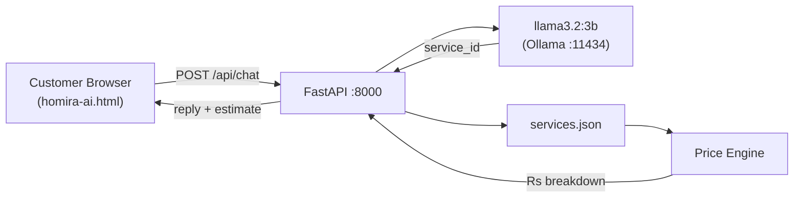

# Homira AI 🏠🤖

> An open-weight AI home-services assistant that understands household repair requests in English and Roman Urdu, asks clarifying questions, and produces transparent price estimates from a verified service catalog.

Built for **Hacktoberfest Islamabad 2026 — Open AI Build Challenge**

[](LICENSE)
[](https://www.python.org/)
[](https://ollama.com/library/llama3.2)

---

## Problem

Customers describing home repair problems face two friction points:

1. **Language barrier** — Standard booking forms don't understand natural language like _"Mere ghar mein pani ki leakage hai"_ or _"AC thanda nahi kar raha"_.
2. **Price opacity** — Getting a quote requires a phone call; customers don't know the approximate cost before committing.

## Solution

Homira AI is a chatbot integrated into the existing Homira home-services website. Customers describe their problem in plain English or Roman Urdu. The assistant:

1. Understands the problem via an open-weight language model.
2. Asks one focused follow-up question when information is missing.
3. Selects the matching service from Homira's verified catalog.
4. Returns a price estimate calculated by deterministic backend code — the LLM never touches the arithmetic.
5. Detects dangerous situations (gas leaks, sparks, fire) and provides safety guidance before any estimate.
6. Offers a direct path to Homira's booking form.

---

## AI Model

| Field | Value |
|---|---|
| Model | `llama3.2:3b` |
| Parameters | 3.2 billion |
| License | [Meta Llama 3.2 Community License](https://www.llama.com/llama3_2/license/) |
| Runtime | [Ollama](https://ollama.com/) (local CPU inference) |
| API protocol | Ollama `/api/chat` (OpenAI-compatible) |
| GPU required | No — runs on CPU |

**Why this model?**
- Under the 8B parameter limit.
- Strong instruction following for triage-style conversations.
- Handles English and Roman Urdu in the same conversation.
- Free, offline, no API key — runs on a development laptop during the hackathon.

---

## Architecture

```
Customer (browser)
  └── homira-ai.html (vanilla JS chatbot widget)
        └── POST /api/chat ──► FastAPI backend (main.py :8000)
                                  ├── Safety check (keyword filter)
                                  ├── Ollama /api/chat ──► llama3.2:3b
                                  │     └── returns service_id + reply
                                  ├── Price engine (deterministic Python)
                                  │     └── reads services.json catalog
                                  └── Structured JSON response ──► browser
```



---

## Project Structure

```
homira-ai/
├── homira-ai.html          # Modified Homira website with chatbot integrated
├── build_html.py           # Script that injects chatbot into original HTML
├── README.md
├── LICENSE                 # MIT + third-party notices
├── HACKATHON.md            # Hackathon-specific documentation
├── .gitignore
│
└── backend/
    ├── main.py             # FastAPI app (AI workflow + price engine)
    ├── requirements.txt    # Python dependencies (pinned)
    ├── .env.example        # Environment variable template
    ├── data/
    │   └── services.json   # Service catalog (SAMPLE RATES — replace with real prices)
    └── tests/
        └── test_backend.py # 35 automated tests
```

---

## Prerequisites

- Python 3.10 or newer
- [Ollama](https://ollama.com/download) — free, runs locally

---

## Installation

### 1. Clone the repository

```bash
git clone https://github.com/YOUR_USERNAME/homira-ai.git
cd homira-ai
```

### 2. Install Python dependencies

```bash
cd backend
pip install -r requirements.txt
```

### 3. Configure environment

```bash
cp .env.example .env
# Edit .env if needed (defaults work for local Ollama)
```

Default `.env` values that work out of the box:
```
OLLAMA_BASE_URL=http://localhost:11434
OLLAMA_MODEL=llama3.2:3b
FRONTEND_URL=http://localhost:3000
```

### 4. Install and start Ollama

Download from [ollama.com/download](https://ollama.com/download), then:

```bash
# Start Ollama (runs in background)
ollama serve

# Pull the model (~2 GB download, one time)
ollama pull llama3.2:3b

# Verify
ollama list
# Should show: llama3.2:3b
```

### 5. Start the backend

```bash
# From the backend/ directory
python -m uvicorn main:app --reload
```

Backend runs at `http://localhost:8000`. Verify:
```
http://localhost:8000/health
```
Expected response:
```json
{"status":"ok","model":"llama3.2:3b","ollama":"connected","catalog_services":12}
```

### 6. Open the website

Open `homira-ai.html` directly in a browser:
```bash
# Windows
start homira-ai.html

# macOS
open homira-ai.html

# Linux
xdg-open homira-ai.html
```

> **Note:** Opening via `file://` works for the basic website. For full CORS support
> between the HTML and backend, serve it over HTTP:
> ```bash
> python -m http.server 3000 --directory . --bind 127.0.0.1
> # Then open http://localhost:3000/homira-ai.html
> ```

---

## Service Catalog Configuration

The service catalog is `backend/data/services.json`. It contains:

- `service_id` — unique identifier used by the AI and price engine
- `service_name` — human-readable name
- `category` — plumbing / electrician / ac_services
- `base_price` — price in PKR (SAMPLE — replace with real rates)
- `pricing_type` — `fixed` or `estimate`
- `unit` — per visit / per fan / etc.
- `active` — set `false` to disable without deleting
- `keywords` — used in prompts to help the model

**⚠️ The current prices are derived from the Homira website's listed prices and must
be verified and replaced with official rates before any commercial deployment.**

---

## Running Tests

```bash
cd backend
python -m pytest tests/test_backend.py -v
```

Expected output:
```
35 passed, 4 skipped in ~5s
```

The 4 skipped tests are **live inference tests** that require Ollama running with
`llama3.2:3b` downloaded. To run them:

```bash
# Start Ollama first, then:
python -m pytest tests/test_backend.py -v -k "Live"
```

### What is tested

| # | Test | Type |
|---|---|---|
| 1 | Plumbing price (PLM-003, Rs 800) | Unit |
| 2 | Electrical price (ELC-001, Rs 700) | Unit |
| 3 | Quantity multiplication | Unit |
| 4 | Unknown service_id raises | Unit |
| 5 | Invalid service_id format raises | Unit |
| 6 | Quantity = 0 raises | Unit |
| 7 | Quantity > 20 raises | Unit |
| 8 | Negative quantity raises | Unit |
| 9 | Estimate-type has is_estimate=True | Unit |
| 10 | Fixed-type has is_estimate=False | Unit |
| 11 | Prices come from catalog (not LLM) | Unit |
| 12 | Gas leak triggers safety alert | Unit |
| 13 | Sparks triggers safety alert | Unit |
| 14 | Burning smell triggers safety alert | Unit |
| 15 | Normal plumbing = not dangerous | Unit |
| 16 | Normal electrical = not dangerous | Unit |
| 17 | Roman Urdu normal = not dangerous | Unit |
| 18 | Action JSON extracted correctly | Unit |
| 19 | No JSON = returns None | Unit |
| 20 | Malformed JSON = returns None | Unit |
| 21 | Action block stripped from reply | Unit |
| 22 | /api/estimate valid → Rs 800 | API |
| 23 | /api/estimate invalid ID → 400 | API |
| 24 | /api/estimate quantity=0 → 422 | API |
| 25 | /api/estimate unknown ID → 400 | API |
| 26 | Estimate includes disclaimer | API |
| 27 | /api/services returns services | API |
| 28 | keywords NOT in public response | API |
| 29 | Safety alert for dangerous message | API (mocked) |
| 30 | Empty message rejected 422 | API |
| 31 | Message >1000 chars rejected | API |
| 32 | Ollama unavailable → error | API (mocked) |
| 33 | Model estimate → real catalog price | API (mocked) |
| 34 | Model hallucinated ID handled | API (mocked) |
| 35 | Ollama timeout → friendly error | API (mocked) |
| 36–39 | Live inference (Ollama) | Live (skip) |

---

## Demo

**2-minute demo script for judges:**

1. Open `homira-ai.html` in a browser — Homira website appears intact.
2. Navigate to Services and Booking pages — all existing functionality works.
3. Click the chat button (bottom-right, above WhatsApp button).
4. Type: _"My kitchen tap is leaking"_ → assistant asks a follow-up.
5. Type: _"From the tap itself, it drips constantly"_ → estimate card: Rs 800 fixed.
6. Click **Book This Service** → redirects to booking page.
7. Type: _"There are sparks coming from my socket"_ → safety alert (no price).
8. Type: _"Mere room ka switch kaam nahi kar raha"_ → understands Roman Urdu.
9. Show `http://localhost:8000/health` → JSON: model connected, 12 services.
10. Run: `python -m pytest tests/test_backend.py -v` → 35 tests pass.

---

## API Reference

### POST /api/chat

```json
{
  "message": "My kitchen tap is leaking",
  "history": [
    {"role": "user", "content": "..."},
    {"role": "assistant", "content": "..."}
  ]
}
```

Response:
```json
{
  "success": true,
  "reply": "I can help with that! Is the leak from the tap or the pipe below?",
  "estimate": null,
  "is_safety_alert": false,
  "latency_ms": 1240
}
```

With estimate:
```json
{
  "success": true,
  "reply": "Here is your estimate for a Tap Repair:",
  "estimate": {
    "service_id": "PLM-003",
    "service_name": "Tap Repair",
    "category": "plumbing",
    "pricing_type": "fixed",
    "base_price": 800,
    "quantity": 1,
    "subtotal": 800,
    "currency": "PKR",
    "is_estimate": false,
    "disclaimer": "This is an estimate based on the information provided..."
  },
  "is_safety_alert": false
}
```

### POST /api/estimate

```json
{"service_id": "PLM-003", "quantity": 1}
```

### GET /api/services

Returns the full active service catalog (keywords excluded).

---

## Known Limitations

1. Ollama must run locally. If unavailable, the website works but AI replies with an offline message.
2. Roman Urdu support is best-effort (common phrases work well; complex mixed-script may reduce accuracy).
3. Safety detector uses keyword matching, not semantic AI — may miss unusual phrasing.
4. Service prices are sample data. Replace with verified rates before launch.
5. For production: add HTTPS, rate limiting, and serve via a proper static server.

---

## Team

- **[Your Name]** — [Your Role]
- _(Add other team members here)_

---

## License

MIT License — see [LICENSE](LICENSE).

Third-party models and libraries retain their own licenses. See LICENSE for full
acknowledgements, particularly the Meta Llama 3.2 Community License which governs
model use.

---

## Acknowledgements

- [Ollama](https://ollama.com/) for making local LLM inference straightforward
- [Meta AI](https://ai.meta.com/) for the Llama 3.2 open-weight models
- [FastAPI](https://fastapi.tiangolo.com/) for the backend framework
- The original Homira website design and branding
- Hacktoberfest Islamabad 2026 organizers
